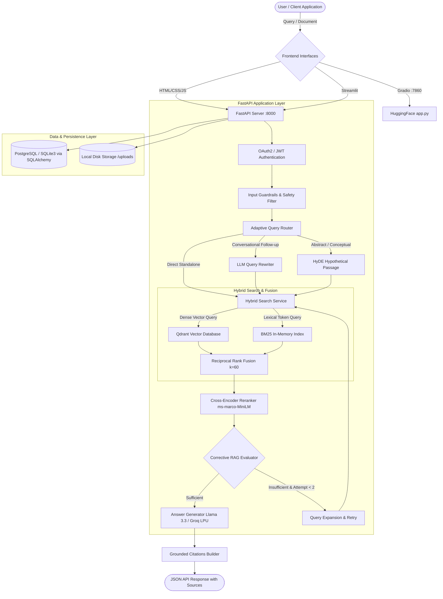
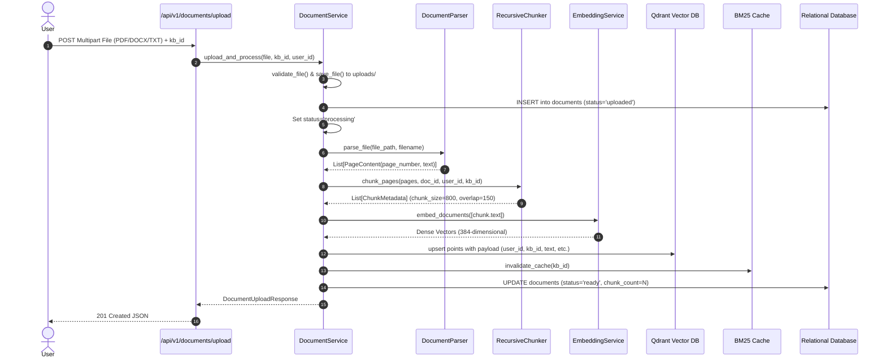
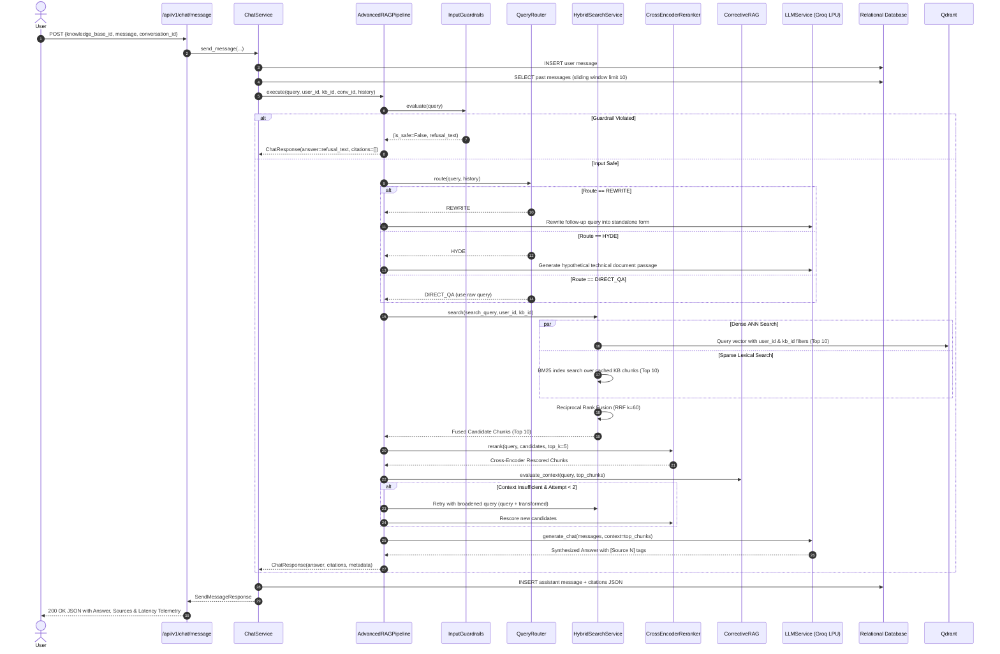
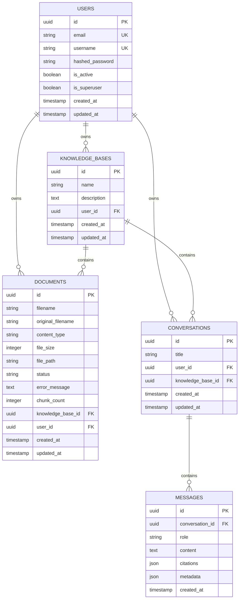

# Comprehensive Technical Interview Preparation Guide: Enterprise Advanced RAG Assistant (Nexus AI)

---

## 1. Project Overview

### 1.1 What the Project Does & Its Purpose
**Nexus AI** is an enterprise-grade, production-ready **Retrieval-Augmented Generation (RAG) Knowledge Assistant**. It is engineered to solve the primary challenges facing standard naive RAG systems in production: **hallucinations, retrieval semantic drift, conversational context loss, keyword vs. semantic recall mismatch, and API rate-limiting vulnerabilities**.

The platform allows enterprise users to authenticate, create isolated multi-tenant knowledge bases, upload multi-format documents (PDF, DOCX, TXT, MD, CSV), automatically parse and semantically chunk them, index them into dense vector embeddings and sparse lexical indices, and conduct grounded multi-turn conversations with verifiable page-level and snippet-level citations.

### 1.2 Main Features
1. **Multi-Stage Advanced RAG Engine**:
   - **Pre-Retrieval Input Guardrails**: Regex-based multilingual filter blocking profanity (English, Hindi, Hinglish) and prompt injection/jailbreak attempts (`ignore all previous instructions`, `DAN mode`).
   - **Adaptive Query Routing (`QueryRouter`)**: Classifies queries into `DIRECT_QA`, `REWRITE` (contextual resolution), or `HYDE` (Hypothetical Document Embeddings).
   - **Conversational Query Reformulation (`QueryRewriter`)**: Resolves ambiguous pronouns and conversational references into self-contained standalone search queries.
   - **Hypothetical Document Embeddings (`HyDEGenerator`)**: Synthesizes synthetic technical handbook passages for abstract/conceptual queries to bridge vector vocabulary mismatch.
   - **Hybrid Retrieval (Dense + Sparse)**: Combines dense vector semantic search (`BAAI/bge-small-en-v1.5` via ONNX FastEmbed) with sparse BM25 lexical search (Robertson-Spärck Jones IDF with custom tokenization preserving error IDs and technical terms).
   - **Reciprocal Rank Fusion (RRF)**: Merges disparate rank distributions using constant smoothing ($k=60$) without score calibration errors.
   - **Cross-Encoder Reranking (`CrossEncoderReranker`)**: Evaluates deep query-chunk joint attention using `Xenova/ms-marco-MiniLM-L-6-v2` to filter out false-positive embeddings before LLM ingestion.
   - **Corrective RAG (CRAG)**: Evaluates context relevance via score heuristics and LLM evaluation, triggering automatic retrieval retries with expanded query terms if initial context is insufficient.
   - **Grounded Generation & Citation Attribution**: Injects strict document context with page/chunk tags and generates structured citations (`[Source N]`, filename, page number, snippet).
2. **Multi-Key LLM Failover & Load Balancing**:
   - Round-robin pool over multiple Groq API keys to distribute RPM/TPM load.
   - Dynamic fallback cascade across models (`openai/gpt-oss-120b`, `openai/gpt-oss-20b`, `groq/compound-mini`, `qwen/qwen3.6-27b`).
   - Automatic `<think>` and Chain-of-Thought scratchpad stripping (`clean_thinking_process`).
   - Auto-compaction & token-budget retry upon HTTP 400 context length overflows.
3. **Multi-Tenant Knowledge Isolation**:
   - Complete tenant isolation at both the relational database level (Foreign Keys linked to `user_id`) and vector database level (Qdrant payload keyword indexing on `user_id` and `knowledge_base_id`).
4. **Tri-Modal Interface Architecture**:
   - **Primary Web UI**: Modern, responsive, glassmorphic single-page web app built with vanilla HTML5, CSS3, and JavaScript, served directly by FastAPI.
   - **Streamlit Analytics UI**: Multi-page dashboard for document and conversation management (`frontend/app.py`).
   - **Hugging Face Spaces Native Gradio App**: Standalone Gradio interface (`app.py`) for zero-friction cloud deployment.

### 1.3 High-Level System Architecture



### 1.4 Technology Stack

| Layer | Technology | Version / Spec | Purpose in Project |
| :--- | :--- | :--- | :--- |
| **Backend Framework** | FastAPI | `>=0.115.0` | Async REST API, OpenAPI docs, static asset serving, exception handling |
| **ASGI Server** | Uvicorn | `>=0.30.0` | High-performance ASGI web server |
| **Relational Database** | PostgreSQL / SQLite | SQLAlchemy `2.0+` | User identities, knowledge bases, documents, conversation history |
| **Database Migrations**| Alembic | `>=1.13.2` | Schema version control and database migration tracking |
| **Vector Database** | Qdrant | `v1.11.0` / Client `>=1.11.0` | Dense vector storage with payload-based multi-tenant isolation |
| **Dense Embeddings** | FastEmbed (`bge-small-en-v1.5`)| Dim: `384` | CPU-optimized ONNX dense sentence embeddings |
| **Lexical Search** | Custom BM25 Engine | $k_1=1.5, b=0.75$ | In-memory tokenized sparse index with RSJ IDF |
| **Reranker** | FastEmbed / Cross-Encoder | `ms-marco-MiniLM-L-6-v2` | Pairwise joint attention passage re-scoring |
| **LLM Inference** | Groq Cloud LPU SDK | `>=0.11.0` | Ultra-low latency generation with failover pools |
| **Authentication** | python-jose & bcrypt | JWT HS256, bcrypt salt | Secure password hashing and stateless JWT bearer tokens |
| **Document Parsers** | PyPDF, python-docx | PyPDF 4.3+, docx 1.1+ | Extraction of text with page-number tracking |
| **Frontends** | HTML5/CSS3/JS, Streamlit, Gradio | Vanilla ES6+, Gradio 4.44+ | Tri-modal client interface support |

---

## 2. File Structure & Responsibilities

```
Advanced RAG Chatbot/
│
├── backend/                                # Backend core application package
│   ├── alembic/                            # Database migrations environment
│   │   ├── versions/
│   │   │   └── 001_initial_schema.py       # Initial DDL migration script
│   │   └── env.py                          # Alembic runtime config linked to Base.metadata
│   ├── app/
│   │   ├── api/                            # API presentation & routing layer
│   │   │   ├── deps.py                     # Dependency injection (get_db, get_current_user)
│   │   │   └── v1/
│   │   │       ├── router.py               # Aggregated v1 API router
│   │   │       └── endpoints/              # Modular controller endpoints
│   │   │           ├── auth.py             # User registration & token generation
│   │   │           ├── chat.py             # Message dispatch, chat history, direct gen
│   │   │           ├── documents.py        # Upload, parse, list, and delete documents
│   │   │           ├── health.py           # System status, DB & Qdrant ping checks
│   │   │           ├── knowledge_bases.py  # CRUD operations for isolated knowledge bases
│   │   │           └── users.py            # User profile management
│   │   ├── core/                           # System-wide configuration & infrastructure
│   │   │   ├── config.py                   # Pydantic BaseSettings loading from .env
│   │   │   ├── exceptions.py               # Custom hierarchy & global FastAPI handlers
│   │   │   ├── guardrails.py               # Multilingual profanity & jailbreak filters
│   │   │   ├── logging.py                  # Standardized logging setup
│   │   │   └── security.py                 # Bcrypt hashing & JWT creation/verification
│   │   ├── db/                             # Persistence & ORM infrastructure
│   │   │   ├── base.py                     # DeclarativeBase & dialect-agnostic GUID type
│   │   │   └── session.py                  # Engine creation, SQLite pragma & SessionLocal
│   │   ├── models/                         # SQLAlchemy 2.0 ORM domain entities
│   │   │   ├── conversation.py             # Chat sessions linked to User & KnowledgeBase
│   │   │   ├── document.py                 # Document metadata, status, chunk counts
│   │   │   ├── knowledge_base.py           # Tenant boundary for documents & chats
│   │   │   ├── message.py                  # User/Assistant turns with citations JSON
│   │   │   └── user.py                     # User accounts, credentials, superuser flags
│   │   ├── rag/                            # RAG algorithms & retrieval pipeline
│   │   │   ├── chunker.py                  # Recursive character chunker with overlap
│   │   │   ├── corrective.py               # CRAG evaluator with relevance threshold & retry
│   │   │   ├── embeddings.py               # FastEmbed dense embedding wrapper
│   │   │   ├── generator.py                # Grounded prompt builder & citation extractor
│   │   │   ├── hybrid_search.py            # Dense + BM25 search + RRF fusion
│   │   │   ├── hyde.py                     # Hypothetical document synthesis
│   │   │   ├── parser.py                   # Multi-format document parser (PDF, DOCX, TXT)
│   │   │   ├── pipeline.py                 # End-to-end 7-stage orchestrator
│   │   │   ├── reranker.py                 # ONNX Cross-Encoder re-scoring
│   │   │   ├── rewriter.py                 # Contextual conversational query rewriter
│   │   │   ├── router.py                   # Strategy classification (DIRECT_QA, REWRITE, HYDE)
│   │   │   └── sparse.py                   # Pure Python BM25 index with RSJ smoothing
│   │   ├── schemas/                        # Pydantic v2 validation contracts
│   │   │   ├── auth.py, chat.py, common.py, document.py, knowledge_base.py, rag.py, user.py
│   │   ├── services/                       # Business logic services
│   │   │   ├── auth_service.py             # User lookup, auth, registration logic
│   │   │   ├── chat_service.py             # Conversation lifecycle & RAG orchestration
│   │   │   ├── document_service.py         # File storage, parsing, vector upsert, cleanup
│   │   │   ├── kb_service.py               # KnowledgeBase CRUD & vector index cleanup
│   │   │   ├── llm_service.py              # Multi-key pool, model fallback, COT stripper
│   │   │   └── vector_service.py           # Qdrant client, collection DDL, tenant filters
│   │   └── main.py                         # FastAPI factory, lifespan, CORS, static routes
│   ├── tests/                              # Comprehensive PyTest test suite (9 test suites)
│   │   ├── test_auth.py, test_chat.py, test_db.py, test_documents.py, test_health.py,
│   │   ├── test_hybrid_search.py, test_kb.py, test_rag_pipeline.py, test_vector_store.py
│   │   └── requirements.txt
│   └── Dockerfile                          # Production container image for backend
│
├── frontend/                               # Streamlit application alternative
│   ├── components/                         # Auth, citations, sidebar UI components
│   ├── services/api_client.py              # Python HTTP client talking to backend /api/v1
│   ├── app.py                              # Streamlit main entrypoint
│   └── Dockerfile                          # Production container image for frontend
│
├── app.py                                  # Gradio Hugging Face Spaces native entrypoint
├── run.py                                  # CLI launcher for backend Uvicorn server
├── index.html, style.css, script.js        # High-performance Vanilla JS Web Client
├── docker-compose.yml                      # Full-stack composition (Postgres, Qdrant, Backend, Frontend)
├── requirements.txt                        # Unified dependencies
└── .env.example                            # Configuration environment template
```

---

## 3. Detailed Functionalities & System Mechanics

### 3.1 Input Guardrails & Safety Filter
- **Where**: `backend/app/core/guardrails.py`
- **Internal Mechanism**:
  Before any LLM or retrieval resource is consumed, the incoming prompt is evaluated against a pre-compiled set of regex patterns covering:
  1. Multilingual profanity and abuse (English slangs, Hindi, and Hinglish abusive terms).
  2. Prompt injection and jailbreak signatures (`ignore all previous instructions`, `reveal system prompt`, `system override mode`, `dan mode`).
- **Execution Flow**:
  If a regex match is triggered, execution halts immediately without hitting the vector database or LLM. The system returns an HTTP 200 response containing a polite refusal: `"I cannot fulfill this request as it contains inappropriate, offensive language or violates enterprise safety policies..."` with metadata `"guardrail_status": "BLOCKED"`.

### 3.2 Adaptive Query Routing (`QueryRouter`)
- **Where**: `backend/app/rag/router.py`
- **Internal Mechanism**:
  Analyzes the user's latest query along with recent conversation history and determines the optimal retrieval path:
  1. **Chit-Chat / Greetings Fast-Path**: If the query matches common greetings (`hi`, `hello`, `who are you`), it bypasses all vector and lexical retrieval and routes directly to the LLM as `DIRECT_QA` with 0 retrieval overhead.
  2. **Conversational Pronoun Heuristic**: If conversation history exists and the user asks a short query ($\le 7$ words) containing ambiguous pronouns (`it`, `its`, `they`, `them`, `that`, `this`, `why?`, `how?`), the router selects `REWRITE` without requiring an extra LLM call.
  3. **LLM Classification Path**: For complex queries, a fast router model (`groq/compound-mini`) is invoked with zero temperature to classify the input into `DIRECT_QA`, `REWRITE`, or `HYDE`.

### 3.3 Contextual Query Rewriting (`QueryRewriter`)
- **Where**: `backend/app/rag/rewriter.py`
- **Internal Mechanism**:
  When a user asks: `"What is its timeout and how do I configure it?"` after discussing `QdrantClient`, standard dense retrieval fails because "it" has no semantic connection to Qdrant.
  The `QueryRewriter` receives the last 6 turns of conversation and formats a few-shot reformulation prompt. The LLM generates a self-contained query: `"What is the timeout for QdrantClient and how is it configured in settings?"`
  The rewritten query replaces the raw query for downstream retrieval while preserving the original user question for the final response.

### 3.4 Hypothetical Document Embeddings (HyDE)
- **Where**: `backend/app/rag/hyde.py`
- **Internal Mechanism**:
  When users pose high-level, speculative, or conceptual queries (e.g., *"Explain our disaster recovery replication strategy"*), the raw query vector often lands far from the actual technical implementation passages in vector space (query-document semantic gap).
  HyDE instructs the LLM to generate a hypothetical, detailed technical passage answering the question. Even if the passage contains hallucinated details, its vector representation captures the *domain vocabulary, stylistic structure, and semantic geometry* of technical documentation. This hypothetical document is embedded and used to retrieve the true candidate chunks.

### 3.5 Hybrid Search Engine: Dense Vector + BM25 Sparse Lexical
- **Where**: `backend/app/rag/hybrid_search.py`, `backend/app/rag/sparse.py`, `backend/app/services/vector_service.py`
- **Internal Mechanism**:
  1. **Dense Retrieval**:
     FastEmbed generates a 384-dimensional dense embedding using `BAAI/bge-small-en-v1.5`. Qdrant performs Approximate Nearest Neighbor (ANN) search using cosine distance:
     $$\text{Cosine Similarity} = \frac{\mathbf{u} \cdot \mathbf{v}}{\|\mathbf{u}\|_2 \|\mathbf{v}\|_2}$$
     A strict payload filter guarantees that only points where `user_id == current_user.id` and `knowledge_base_id == active_kb.id` are searched.
  2. **Sparse Lexical Retrieval (BM25)**:
     Built-in implementation of the Okapi BM25 ranking function. When a query is received, it is tokenized using alphanumeric boundary matching that explicitly preserves symbols like underscores and hyphens (vital for code identifiers, error codes like `ERR_AUTH_042`, and config flags). Stopwords are removed.
     The score for document $D$ given query $Q$ is calculated as:
     $$\text{Score}(D, Q) = \sum_{q \in Q} \text{IDF}(q) \cdot \frac{f(q, D) \cdot (k_1 + 1)}{f(q, D) + k_1 \cdot \left(1 - b + b \cdot \frac{|D|}{\text{avgdl}}\right)}$$
     where Robertson-Spärck Jones IDF is computed as:
     $$\text{IDF}(q) = \ln\left(1 + \frac{N - n(q) + 0.5}{n(q) + 0.5}\right)$$
     with defaults $k_1 = 1.5$ and $b = 0.75$.
  3. **Zero-Latency In-Memory BM25 Caching**:
     The system maintains an in-memory cache of built BM25 indices keyed by `user_id:kb_id`. First query builds the index by scrolling Qdrant points; subsequent queries hit memory with 0ms build overhead. When a new document is added or deleted, `invalidate_cache(kb_id)` flushes the entry.

### 3.6 Reciprocal Rank Fusion (RRF)
- **Where**: `backend/app/rag/hybrid_search.py`
- **Internal Mechanism**:
  Dense similarity scores (typically between $0.0$ and $1.0$) and BM25 scores (unbounded positive values like $14.2$) cannot be directly added or normalized without severe distribution distortions.
  Nexus AI uses **Reciprocal Rank Fusion (RRF)**:
  $$\text{RRF\_Score}(d \in D) = \sum_{m \in M} \frac{1}{k + r_m(d)}$$
  where $M = \{\text{Dense}, \text{Sparse}\}$, $r_m(d)$ is the 1-based rank of document $d$ in system $m$, and $k$ is the smoothing constant (configured to $60$).
  This guarantees that documents appearing near the top of *both* dense and sparse candidate lists receive exponential boosts, while preventing one retrieval mechanism from dominating.

### 3.7 Cross-Encoder Reranking
- **Where**: `backend/app/rag/reranker.py`
- **Internal Mechanism**:
  Bi-encoder embeddings compute representations of query and document independently ($\mathbf{u} = \text{Embed}(Q)$, $\mathbf{v} = \text{Embed}(D)$), meaning cross-attention between specific query terms and document tokens is lost.
  The `CrossEncoderReranker` takes the top candidates from RRF and feeds the exact pair $(Q, D)$ into `Xenova/ms-marco-MiniLM-L-6-v2`. This model processes all tokens jointly through deep transformer self-attention layers, outputting a precise scalar relevance logit. Chunks are re-sorted by this logit, and only the top $K$ (default 5) proceed to answer generation.

### 3.8 Corrective RAG (CRAG) & Query Expansion
- **Where**: `backend/app/rag/corrective.py`
- **Internal Mechanism**:
  Prevents the LLM from hallucinating when retrieval fails to find relevant information.
  1. **Score Fast-Path**: If the top chunk's cross-encoder score is $\ge -1.5$, the context is accepted immediately as `RELEVANT` (0ms overhead).
  2. **LLM Relevance Evaluation**: If scores are low or ambiguous, a fast LLM evaluator assesses whether the context contains the facts needed to answer the question.
  3. **Retire / Expand Query**: If the evaluator returns `INSUFFICIENT` and attempt $< 2$, CRAG triggers an automatic retry: it concatenates the original query with the reformulated query (`query + " " + transformed_query`), executes an expanded hybrid search, re-ranks the new candidates, and evaluates again.
  4. If context remains insufficient, it sets `insufficient_context = True`, directing the generator to fall back gracefully.

### 3.9 Multi-Key Groq LPU Engine & Failover Cascade
- **Where**: `backend/app/services/llm_service.py`
- **Internal Mechanism**:
  - **Round-Robin Multi-Key Pool**: Accepts `GROQ_API_KEYS` as a list or comma-separated string. Each generation request rotates the client index (`self._key_index = (self._key_index + 1) % len(clients)`), effectively multiplying rate limits (RPM and TPM) by the number of configured keys.
  - **Model Failover Cascade**: If a call fails due to rate-limiting (HTTP 429), server overload (HTTP 503), or deprecation, it tries candidate models in sequence:
    `openai/gpt-oss-120b` $\rightarrow$ `openai/gpt-oss-20b` $\rightarrow$ `groq/compound-mini` $\rightarrow$ `groq/compound` $\rightarrow$ `qwen/qwen3.6-27b`.
  - **Context Window Auto-Recovery**: If a token limit error (`reduce the length` or HTTP 400) occurs, it automatically truncates user context to 3,000 characters and lowers `max_tokens` to 768 before retrying.
  - **CoT Artifact Stripper**: Uses regex to strip raw `<think>...</think>` tags and prompt analysis preambles generated by reasoning models.

---

## 4. Code Deep Dive: Core Snippets & Line-by-Line Logic

### 4.1 Recursive Chunker with Overlap Preservation
- **File**: `backend/app/rag/chunker.py`

```python
# Lines 19-70 in backend/app/rag/chunker.py
def _split_text(self, text: str, separators: List[str]) -> List[str]:
    final_chunks = []
    if not separators:
        return [text]

    separator = separators[0]
    new_separators = separators[1:]

    if separator == "":
        splits = list(text)
    else:
        splits = text.split(separator)

    current_doc = []
    total = 0

    for s in splits:
        s_len = len(s) + (len(separator) if current_doc else 0)
        if total + s_len <= self.chunk_size:
            current_doc.append(s)
            total += s_len
        else:
            if current_doc:
                joined = separator.join(current_doc)
                if joined.strip():
                    final_chunks.append(joined.strip())
                
                # Compute overlap from previous chunks
                overlap_doc = []
                overlap_len = 0
                for prev in reversed(current_doc):
                    if overlap_len + len(prev) + len(separator) <= self.chunk_overlap:
                        overlap_doc.insert(0, prev)
                        overlap_len += len(prev) + len(separator)
                    else:
                        break
                current_doc = overlap_doc
                total = overlap_len

            if len(s) > self.chunk_size and new_separators:
                sub_chunks = self._split_text(s, new_separators)
                final_chunks.extend(sub_chunks)
            else:
                current_doc.append(s)
                total += len(s)

    if current_doc:
        joined = separator.join(current_doc)
        if joined.strip():
            final_chunks.append(joined.strip())

    return final_chunks
```
**Explanation & Logic**:
- **Hierarchy of Separators**: Recursively descends through `["\n\n", "\n", ". ", "? ", "! ", " ", ""]`. It first preserves paragraph boundaries, then sentences, then words.
- **Overlap Backtracking**: When the character limit (`chunk_size=800`) is reached, instead of hard slicing, it iterates in reverse through `current_doc` to retain preceding text up to `chunk_overlap=150` characters. This prevents fragmented sentences across chunk boundaries.

---

### 4.2 Reciprocal Rank Fusion (RRF) Implementation
- **File**: `backend/app/rag/hybrid_search.py`

```python
# Lines 13-53 in backend/app/rag/hybrid_search.py
class ReciprocalRankFusion:
    @staticmethod
    def fuse(
        ranked_lists: List[List[ScoredChunk]],
        k: int = 60,
        top_k: int = 20
    ) -> List[ScoredChunk]:
        """Combines multiple ranked lists using Reciprocal Rank Fusion (RRF).
        RRF_Score(d) = SUM_{m in M} (1 / (k + rank_m(d)))
        """
        chunk_map: Dict[str, ScoredChunk] = {}
        rrf_scores: Dict[str, float] = {}

        for rank_list in ranked_lists:
            for rank, chunk in enumerate(rank_list, start=1):
                chunk_id = chunk.chunk_id
                chunk_map[chunk_id] = chunk
                score_increment = 1.0 / (k + rank)
                rrf_scores[chunk_id] = rrf_scores.get(chunk_id, 0.0) + score_increment

        sorted_chunk_ids = sorted(rrf_scores.keys(), key=lambda cid: rrf_scores[cid], reverse=True)

        fused_results: List[ScoredChunk] = []
        for cid in sorted_chunk_ids[:top_k]:
            original = chunk_map[cid]
            fused_results.append(
                ScoredChunk(
                    chunk_id=original.chunk_id,
                    document_id=original.document_id,
                    user_id=original.user_id,
                    knowledge_base_id=original.knowledge_base_id,
                    filename=original.filename,
                    page_number=original.page_number,
                    chunk_index=original.chunk_index,
                    text=original.text,
                    score=float(rrf_scores[cid]),
                    retrieval_type="hybrid"
                )
            )

        return fused_results
```
**Explanation & Logic**:
- **Parameters**: `ranked_lists` is a list containing `[dense_results, sparse_results]`. `k=60` is the standard Cormack et al. constant.
- **Rank Accumulation**: For each document, its reciprocal rank $\frac{1}{60 + \text{rank}}$ is accumulated.
- **Normalization Free**: Eliminates the need for MinMax or Z-Score scaling, ensuring consistent fusion regardless of raw score scale differences.

---

### 4.3 Multi-Tenant Dense Vector Search with Payload Filtering
- **File**: `backend/app/services/vector_service.py`

```python
# Lines 142-200 in backend/app/services/vector_service.py
def dense_search(
    self,
    query: str,
    user_id: uuid.UUID,
    kb_id: uuid.UUID,
    top_k: int = 20,
    collection_name: Optional[str] = None
) -> List[ScoredChunk]:
    client = self.get_client()
    col_name = collection_name or settings.QDRANT_COLLECTION_NAME
    self.ensure_collection_exists(col_name)

    try:
        query_vector = embedding_service.embed_query(query)

        # Enforce strict multi-tenant isolation
        tenant_filter = Filter(
            must=[
                FieldCondition(
                    key="user_id",
                    match=MatchValue(value=str(user_id))
                ),
                FieldCondition(
                    key="knowledge_base_id",
                    match=MatchValue(value=str(kb_id))
                )
            ]
        )

        # Query Qdrant with query_points
        query_response = client.query_points(
            collection_name=col_name,
            query=query_vector,
            query_filter=tenant_filter,
            limit=top_k,
            with_payload=True
        )

        scored_chunks = []
        for hit in query_response.points:
            payload = hit.payload or {}
            scored_chunks.append(
                ScoredChunk(
                    chunk_id=payload.get("chunk_id", ""),
                    document_id=uuid.UUID(payload.get("document_id")),
                    user_id=uuid.UUID(payload.get("user_id")),
                    knowledge_base_id=uuid.UUID(payload.get("knowledge_base_id")),
                    filename=payload.get("filename", "unknown"),
                    page_number=payload.get("page_number", 1),
                    chunk_index=payload.get("chunk_index", 0),
                    text=payload.get("text", ""),
                    score=float(hit.score),
                    retrieval_type="dense"
                )
            )

        logger.info(f"Dense search retrieved {len(scored_chunks)} candidate chunks for query '{query[:40]}...'.")
        return scored_chunks

    except Exception as e:
        logger.error(f"Error executing dense search in Qdrant: {str(e)}")
        raise VectorStoreException(message=f"Dense vector retrieval failed: {str(e)}")
```
**Explanation & Logic**:
- **Tenant Isolation**: Uses Qdrant's `Filter(must=[...])` targeting indexed payload fields `user_id` and `knowledge_base_id`.
- **Pre-filtering in HNSW**: Qdrant applies payload filters during graph traversal (not as a post-filter), preventing index contamination and ensuring that User A can never retrieve chunks belonging to User B.

---

### 4.4 End-to-End Advanced RAG Pipeline Execution
- **File**: `backend/app/rag/pipeline.py`

```python
# Lines 17-66 in backend/app/rag/pipeline.py
class AdvancedRAGPipeline:
    def execute(
        self,
        query: str,
        user_id: uuid.UUID,
        kb_id: uuid.UUID,
        conversation_id: uuid.UUID,
        conversation_history: Optional[List[Dict[str, str]]] = None
    ) -> ChatResponse:
        start_time = time.time()
        history = conversation_history or []
        attempt = 1
        transformed_query = query.strip()

        # Step 0: Input Guardrails & Safety Filter
        is_safe, safety_response = guardrails.evaluate(query)
        if not is_safe:
            return ChatResponse(
                conversation_id=conversation_id,
                answer=safety_response,
                citations=[],
                metadata={
                    "guardrail_status": "BLOCKED",
                    "latency_seconds": round(time.time() - start_time, 4)
                }
            )

        # Fast-path for simple greetings/chit-chat (skip retrieval overhead)
        clean_lower = transformed_query.lower().strip("?!.,")
        greetings_set = {"hi", "hello", "hey", "hey there", "good morning", "good afternoon", "good evening", "who are you", "what can you do", "help", "thanks", "thank you"}
        if clean_lower in greetings_set and len(clean_lower.split()) <= 4:
            answer, _ = answer_generator.generate_answer(
                query=query,
                chunks=[],
                conversation_history=history,
                insufficient_context=False
            )
            return ChatResponse(
                conversation_id=conversation_id,
                answer=answer,
                citations=[],
                metadata={
                    "route": "DIRECT_GREETING",
                    "retrieval_attempts": 0,
                    "candidates_retrieved": 0,
                    "top_chunks_used": 0,
                    "latency_seconds": round(time.time() - start_time, 4)
                }
            )
```
**Explanation & Logic**:
- **Zero-Latency Pathing**: Immediate regex safety check and sub-second greeting fast-path prevent unnecessary model loading and vector indexing when users say "Hello".
- **Execution Telemetry**: Calculates exact end-to-end `latency_seconds`, candidate counts, route types, and CRAG statuses, returning rich metadata to the frontend.

---

## 5. Comprehensive Function & Class Inventory

| File Path | Class / Function | Type | Signature | Purpose & Where Used |
| :--- | :--- | :--- | :--- | :--- |
| `backend/app/rag/parser.py` | `DocumentParser.parse_pdf` | Method | `(file_path: str) -> List[PageContent]` | Extracts text page-by-page using `pypdf.PdfReader` with whitespace cleaning; called by `document_service.py`. |
| `backend/app/rag/parser.py` | `DocumentParser.parse_docx` | Method | `(file_path: str) -> List[PageContent]` | Extracts paragraphs from `.docx` via `python-docx`; called by `document_service.py`. |
| `backend/app/rag/chunker.py` | `RecursiveChunker.chunk_pages`| Method | `(pages, doc_id, user_id, kb_id, filename) -> List[ChunkMetadata]` | Slices document text into overlapping chunks, appending deterministic IDs (`docId_pX_cY`). |
| `backend/app/rag/embeddings.py`| `EmbeddingService.embed_query`| Method | `(query: str) -> List[float]` | Adds BGE search prefix and generates 384-d dense vector; called in `vector_service.dense_search`. |
| `backend/app/rag/sparse.py` | `BM25Index.search` | Method | `(query: str, top_k: int) -> List[ScoredChunk]` | Computes Okapi BM25 scores with RSJ IDF over in-memory indexed chunks. |
| `backend/app/rag/hybrid_search.py` | `HybridSearchService.search` | Method | `(query, user_id, kb_id, ...) -> RetrievalResult` | Orchestrates concurrent dense search, cached BM25 search, and RRF fusion. |
| `backend/app/rag/reranker.py` | `CrossEncoderReranker.rerank` | Method | `(query, chunks, top_k) -> List[ScoredChunk]` | Re-scores RRF candidates using joint cross-attention logits from `ms-marco-MiniLM-L-6-v2`. |
| `backend/app/rag/router.py` | `QueryRouter.route` | Method | `(query, history) -> QueryRoute` | Classifies query into `DIRECT_QA`, `REWRITE`, or `HYDE`. |
| `backend/app/rag/rewriter.py` | `QueryRewriter.rewrite` | Method | `(query, history) -> str` | Reformulates conversational follow-up questions using historical context. |
| `backend/app/rag/hyde.py` | `HyDEGenerator.generate_hypothetical_document` | Method | `(query: str) -> str` | Synthesizes a hypothetical technical handbook excerpt to anchor vector search. |
| `backend/app/rag/corrective.py`| `CorrectiveRAG.evaluate_context`| Method | `(query, chunks, attempt) -> Tuple[str, bool]` | Assesses context sufficiency via score threshold or LLM; decides on retry. |
| `backend/app/rag/generator.py` | `AnswerGenerator.generate_answer`| Method | `(query, chunks, history, ...) -> Tuple[str, List[Citation]]` | Formats context and generates grounded answer with `[Source N]` citations. |
| `backend/app/services/vector_service.py` | `VectorService.upsert_chunks` | Method | `(chunks: List[ChunkMetadata]) -> int` | Generates batch embeddings and upserts points with tenant payload to Qdrant. |
| `backend/app/services/llm_service.py` | `LLMService.generate_chat` | Method | `(messages, system_prompt, ...) -> str` | Rotates Groq API keys, strips `<think>` tokens, and handles token overflow retries. |
| `backend/app/services/document_service.py` | `DocumentService.upload_and_process` | Method | `(db, file, kb_id, user_id) -> (Document, chunks)` | Saves file to disk, parses, chunks, indexes in Qdrant, and updates database state. |
| `backend/app/services/chat_service.py` | `ChatService.send_message` | Method | `(db, user_id, kb_id, text, conv_id) -> (...)` | Manages conversation persistence, calls RAG pipeline, and saves user/assistant messages. |
| `backend/app/core/security.py` | `create_access_token` | Function | `(subject, expires_delta) -> str` | Encodes JWT with subject claim (`sub=user_id`) signed via HS256. |
| `backend/app/api/deps.py` | `get_current_user` | Function | `(db, token) -> User` | FastAPI dependency decoding JWT bearer token and loading active user from DB. |

---

## 6. End-to-End Workflows & Data Flows

### 6.1 Application Startup Workflow
1. **Entrypoint Execution**: `python run.py` initializes the process, adds the workspace root to `sys.path`, and starts Uvicorn pointing to `backend.app.main:app`.
2. **Lifespan Manager (`backend/app/main.py:lifespan`)**:
   - Initializes structured logging (`setup_logging()`).
   - Connects to SQLite or PostgreSQL via SQLAlchemy `engine` and executes `Base.metadata.create_all(bind=engine)` to ensure tables (`users`, `knowledge_bases`, `documents`, `conversations`, `messages`) exist.
   - Triggers background warmup: preloads `EmbeddingService`, initializes ONNX runtime for `CrossEncoderReranker`, and checks Qdrant vector database connectivity.
   - Mounts static files (`index.html`, `style.css`, `script.js`, `/uploads`).

### 6.2 Document Ingestion & Indexing Data Flow



### 6.3 Query Execution & RAG Generation Data Flow



---

## 7. Technical Specifications & Integrations

### 7.1 Database Schema & Data Models
The relational schema is defined via SQLAlchemy 2.0 with PostgreSQL native UUIDs and SQLite `CHAR(36)` fallback via the custom `GUID` TypeDecorator (`backend/app/db/base.py`):



### 7.2 Vector Store Multi-Tenant Indexing Details
- **Vector Dimension**: `384` (native output of `bge-small-en-v1.5`).
- **Distance Metric**: `Cosine`.
- **Payload Indexing Schema**:
  To ensure sub-millisecond filtering during HNSW traversal, the collection initializes explicit keyword payload indexes (`backend/app/services/vector_service.py:75-94`):
  ```python
  client.create_payload_index(collection_name=col_name, field_name="user_id", field_schema=models.PayloadSchemaType.KEYWORD)
  client.create_payload_index(collection_name=col_name, field_name="knowledge_base_id", field_schema=models.PayloadSchemaType.KEYWORD)
  client.create_payload_index(collection_name=col_name, field_name="document_id", field_schema=models.PayloadSchemaType.KEYWORD)
  ```
- **Deterministic Point IDs**:
  Qdrant points are keyed using deterministic UUIDv5 hashes derived from chunk string IDs (`uuid.uuid5(uuid.NAMESPACE_DNS, chunk.chunk_id)`), guaranteeing idempotent upserts.

### 7.3 External Integrations & APIs
1. **Groq LPU Inference API**: High-throughput inference for Llama 3.3 70B, GPT-OSS, and Compound models. Connected over HTTPS via official `groq` Python SDK with multi-key round-robin rotation.
2. **Qdrant Vector Database**: Remote cluster connection via HTTP/gRPC or seamless automatic fallback to in-memory storage (`location=":memory:"`) when remote host is unreachable.
3. **FastEmbed (Qdrant ONNX Runtime)**: Local embedded ONNX engine that runs CPU-accelerated dense embeddings and cross-encoders without requiring heavy PyTorch or CUDA dependencies.

---

## 8. Technical Interview Questions & Answers

### Basic Concepts

#### Q1: What is Retrieval-Augmented Generation (RAG) and why is it needed over vanilla LLMs?
**Answer**:
Large Language Models have fixed knowledge cutoffs and are prone to hallucinations when answering domain-specific, proprietary, or evolving enterprise queries. Fine-tuning models on new data is computationally expensive, suffers from catastrophic forgetting, and does not provide auditable provenance.

RAG combines information retrieval with generative LLMs: when a user asks a question, the system queries external document stores (vector/lexical indices), retrieves relevant factual snippets, and presents them as contextual grounding in the prompt to the LLM. This provides three major benefits:
1. Zero training cost for newly added documents.
2. Grounded, verifiable factual responses with exact page and document citations.
3. Strict enterprise access control and data security boundaries.

#### Q2: What is the difference between Dense Retrieval and Sparse Retrieval?
**Answer**:
- **Dense Retrieval** uses deep neural encoders (such as `bge-small-en-v1.5`) to map queries and documents into dense, continuous vector spaces (e.g., 384 dimensions). It excels at capturing semantic intent, synonyms, and paraphrased phrasing (e.g., understanding that "vacation policy" relates to "annual leave"). However, it can miss exact serial numbers, specific error codes, or technical jargon.
- **Sparse Retrieval** (such as BM25) represents documents as high-dimensional, sparse vectors based on exact term frequencies and inverse document frequencies. It excels at exact keyword matching, acronyms, and specialized nomenclature (e.g., finding `ERR_AUTH_042` or `psycopg2-binary`), but fails when queries use synonyms not present in the corpus.
- **Why Hybrid is Better**: In Nexus AI, both methods run concurrently and their outputs are merged via Reciprocal Rank Fusion, capturing both semantic context and exact keyword precision.

---

### Intermediate Architecture & Implementation

#### Q3: Why did you choose Reciprocal Rank Fusion (RRF) instead of linear score combination $(\alpha \cdot \text{Dense} + (1-\alpha) \cdot \text{Sparse})$?
**Answer**:
In `backend/app/rag/hybrid_search.py`, linear score combination requires normalizing dense scores (cosine similarity bounded $[-1, 1]$ or $[0, 1]$) with sparse BM25 scores (unbounded positive floats from $0$ to $\infty$). Normalization techniques like MinMax scaling are unstable because a single outlier BM25 score compresses the rest of the distribution.

RRF operates strictly on the **ordinal rank positions** of items:
$$\text{RRF\_Score}(d) = \sum_{m \in M} \frac{1}{k + r_m(d)}$$
Using constant $k=60$:
1. It is scale-invariant and requires no calibration or score normalization.
2. Items ranked highly in both lists receive an exponential score boost.
3. Items appearing in only one list still receive a fair contribution based on rank position.

#### Q4: Walk through the Cross-Encoder Reranking step. Why not use Cross-Encoders for initial retrieval?
**Answer**:
- **Computational Complexity**: Bi-encoders encode queries and documents independently ($O(N)$ for $N$ documents), allowing millions of document vectors to be pre-indexed into an HNSW graph. ANN search evaluates inner products in sub-milliseconds. A Cross-Encoder, however, must concatenate the query and document into a single sequence $[CLS] + Q + [SEP] + D + [SEP]$ and pass it through all transformer self-attention layers ($O(N \cdot L^2)$ complexity). Running a Cross-Encoder over tens of thousands of chunks per query would cause unacceptable latency (seconds to minutes).
- **Two-Stage Pipeline**: Nexus AI uses the bi-encoder + BM25 to filter tens of thousands of chunks down to 10-20 high-recall candidates in $\approx 15\text{ms}$. Then, `CrossEncoderReranker` (`backend/app/rag/reranker.py`) executes cross-attention scoring on only those top candidates, reordering them with high precision and discarding semantic false positives before sending them to the LLM.

#### Q5: How is multi-tenant security implemented across relational and vector databases?
**Answer**:
1. **Relational Layer**: In SQLAlchemy models (`User`, `KnowledgeBase`, `Document`, `Conversation`), all entities belong to a `user_id`. Every service method (`document_service.py`, `chat_service.py`, `kb_service.py`) checks that the authenticated user (`current_user.id` from JWT) matches the resource owner, throwing `ForbiddenException (403)` on mismatch.
2. **Vector Layer**: In `backend/app/services/vector_service.py`, all document chunks upserted into Qdrant store `user_id` and `knowledge_base_id` in their payload. During query execution, a strict filter is applied:
   ```python
   Filter(must=[
       FieldCondition(key="user_id", match=MatchValue(value=str(user_id))),
       FieldCondition(key="knowledge_base_id", match=MatchValue(value=str(kb_id)))
   ])
   ```
   Because Qdrant indexes these payload keys as `KEYWORD` types, filtering happens directly within the HNSW index graph traversal, guaranteeing complete cryptographic and tenant isolation.

---

### Advanced Concepts, Debugging & Optimization

#### Q6: How does Corrective RAG (CRAG) operate in your pipeline, and what problem does it solve?
**Answer**:
Standard RAG pipelines blindly feed whatever chunks are retrieved into the LLM context. If retrieval fails or returns irrelevant passages, the LLM either produces hallucinations or confesses confusion.

In `backend/app/rag/corrective.py`:
1. **Confidence Threshold**: The pipeline inspects the highest cross-encoder logit among retrieved chunks. If the logit is $\ge -1.5$, it accepts the context as `RELEVANT` without extra latency.
2. **LLM Relevance Gate**: If scores are ambiguous, a fast LLM evaluation prompt checks whether the context contains the necessary facts.
3. **Query Expansion & Recovery**: If evaluated as `INSUFFICIENT` and attempt $< 2$, CRAG triggers an automatic retry: it concatenates the user query with the reformulated query terms, re-queries hybrid search, and re-ranks.
4. **Graceful Fallback**: If still insufficient, it flags `insufficient_context = True`, which instructs the generator to answer conversationally or state that documents lack relevant facts, completely preventing document hallucinations.

#### Q7: How does your Groq LLM service achieve high availability and handle rate limits?
**Answer**:
In `backend/app/services/llm_service.py`:
1. **Round-Robin Multi-Key Pool**: The service loads multiple Groq API keys (`GROQ_API_KEYS`) and rotates through them on each request using an atomic index counter (`self._key_index`). This multiplies the system's effective rate limits (TPM/RPM) across keys.
2. **Model Failover Cascade**: If a model returns an error (rate limits, 503 overload, or context limit), the service automatically attempts a fallback cascade:
   `openai/gpt-oss-120b` $\rightarrow$ `openai/gpt-oss-20b` $\rightarrow$ `groq/compound-mini` $\rightarrow$ `groq/compound` $\rightarrow$ `qwen/qwen3.6-27b`.
3. **Context Length Auto-Compaction**: If an HTTP 400 error (`reduce the length`) occurs, it automatically truncates the prompt to 3,000 characters and retries with a reduced `max_tokens` limit of 768.
4. **CoT Cleansing**: The `clean_thinking_process` helper strips `<think>...</think>` tags and reasoning artifacts so users only see clean, professional output.

#### Q8: What happens when a user deletes a document? Trace the cleanup path across all subsystems.
**Answer**:
In `backend/app/services/document_service.py:178-197`:
1. **Ownership Verification**: Validates that `document.user_id == current_user.id`.
2. **Vector Cleanup**: Calls `vector_service.delete_by_document(doc_id, user_id)`:
   Qdrant executes a point deletion query using a `FilterSelector` matching `document_id` and `user_id`.
3. **BM25 Cache Invalidation**: Calls `hybrid_search_service.invalidate_cache(doc.knowledge_base_id)`, purging the in-memory BM25 index so subsequent lexical searches do not return phantom chunks.
4. **Disk Cleanup**: Deletes the raw physical file from `uploads/{user_id}/{kb_id}/{doc_id}_{filename}` via `os.remove()`.
5. **Relational Cascade**: Executes `db.delete(doc)` and `db.commit()`, deleting the database row and maintaining foreign key integrity.

---

## 9. Interview Presentations: 30-Second, 2-Minute & 5-Minute Pitches

### 9.1 The 30-Second Elevator Pitch
> *"I built **Nexus AI**, an enterprise-grade Advanced RAG Knowledge Assistant designed to eliminate hallucinations and context drift in corporate documentation search. Unlike naive RAG systems that rely solely on vector search, Nexus AI implements an end-to-end multi-stage pipeline: multilingual input guardrails, adaptive query routing with HyDE and conversational rewriting, hybrid search combining dense BGE embeddings with sparse BM25 fused via Reciprocal Rank Fusion, Cross-Encoder reranking, and Corrective RAG with query expansion. The backend is built on FastAPI, SQLAlchemy, and Qdrant with multi-tenant isolation, backed by a resilient Groq LPU engine with multi-key load balancing and model failover."*

### 9.2 The 2-Minute Presentation
> *"In enterprise environments, standard RAG systems frequently fail due to three key issues: keyword search misses semantic synonyms, dense vector search misses technical codes and acronyms, and multi-turn conversations lose context over time.
>
> To solve this, I architected **Nexus AI**.
>
> When a user submits a query, it passes through a 7-stage pipeline:
> First, **Input Guardrails** filter profanity and prompt injections.
> Second, our **Adaptive Query Router** determines whether the query needs conversational reformulation to resolve pronouns, or requires **HyDE**—Hypothetical Document Embeddings—to synthesize an authoritative passage for abstract concepts.
> Third, we run **Hybrid Retrieval**: dense vector search in Qdrant using `BAAI/bge-small-en-v1.5` and sparse lexical search using custom BM25 with Robertson-Spärck Jones IDF. We merge these candidate lists using **Reciprocal Rank Fusion ($k=60$)**, overcoming the score normalization problem.
> Fourth, an ONNX-optimized **Cross-Encoder reranker** (`ms-marco-MiniLM-L-6-v2`) evaluates joint attention between query and chunk tokens to prune false positives.
> Fifth, **Corrective RAG** evaluates retrieval quality; if relevance is insufficient, it triggers automated query expansion and retries.
> Finally, our Groq LPU engine synthesizes a grounded answer with page-level citations.
>
> On the infrastructure side, the application features full multi-tenant isolation across PostgreSQL and Qdrant, a round-robin multi-key pool for Groq to prevent rate-limiting, and three client interfaces: a vanilla HTML5/JS single-page application, a Streamlit dashboard, and a native Gradio app."*

### 9.3 The 5-Minute Deep-Dive Presentation
> *"Good morning. Today I'd like to walk you through **Nexus AI**, an enterprise Knowledge Assistant powered by an Advanced RAG architecture.
>
> ### Problem Statement
> Most production RAG systems suffer from what I call the 'Retrieval Reliability Gap':
> 1. Vector drift: Bi-encoders frequently retrieve chunks that are topically adjacent but factually irrelevant.
> 2. Lexical blindness: Vector models struggle with specific error codes like `ERR_AUTH_042` or exact technical terms.
> 3. Production fragility: Single LLM API keys hit rate limits, and reasoning models dump raw `<think>` tokens into user interfaces.
>
> ### Architecture & Pipeline
> I engineered a multi-stage architecture centered around FastAPI, Qdrant, SQLAlchemy, and Groq:
>
> 1. **Ingestion Engine**: Multi-format document parser (PDF, DOCX, TXT) paired with a recursive character chunker with overlap backtracking. Chunks are converted into 384-dimensional dense vectors using FastEmbed ONNX runtime and stored in Qdrant with indexed metadata payloads.
> 2. **Pre-Retrieval Guardrails & Routing**:
>    - A multilingual regex guardrail intercepts malicious inputs and jailbreaks before consuming downstream resources.
>    - The Query Router classifies queries into `DIRECT_QA`, `REWRITE`, or `HYDE`. For conversational follow-ups, `QueryRewriter` resolves ambiguous pronouns based on sliding-window chat history. For abstract questions, `HyDEGenerator` generates a hypothetical technical passage that bridges the semantic gap in vector space.
> 3. **Hybrid Search & Reciprocal Rank Fusion**:
>    - Rather than relying solely on vectors, we execute dual retrieval: Dense ANN search in Qdrant and Sparse BM25 lexical search over an in-memory token index.
>    - We combine these ranked lists using Reciprocal Rank Fusion with smoothing factor $k=60$. This avoids fragile score normalization and balances semantic recall with exact keyword precision.
> 4. **Post-Retrieval Verification (Cross-Encoder & CRAG)**:
>    - The fused candidates pass to an ONNX cross-encoder (`ms-marco-MiniLM-L-6-v2`) that scores full query-document joint attention.
>    - Next, our Corrective RAG evaluator checks if the top score meets a relevance threshold. If the context is deemed insufficient, the system broadens the query and retries retrieval.
> 5. **Generation & Multi-Key Failover Engine**:
>    - The grounded context is injected into Llama 3.3 70B via Groq.
>    - To guarantee 99.9% uptime, the `LLMService` implements a round-robin rotation over multiple Groq API keys to distribute RPM/TPM load, along with an automatic fallback cascade across backup models. An internal sanitizer strips `<think>` scratchpads and auto-compacts token budgets on HTTP 400 overflows.
>
> ### Results & Engineering Polish
> The system achieves sub-second end-to-end response times, zero-latency caching for lexical indices, verified page-level source citations, and complete multi-tenant isolation verified by 9 test suites covering authentication, DB transactions, hybrid retrieval, and RAG pipelines."*

---

## 10. Limitations, Potential Edge Cases & Proposed Improvements

### 10.1 Identified Limitations & Edge Cases

| Area | Current Implementation | Edge Case / Potential Risk | Production Recommendation |
| :--- | :--- | :--- | :--- |
| **BM25 In-Memory Index** | `_bm25_cache` stores `BM25Index` in server RAM (`backend/app/rag/hybrid_search.py`). | In a multi-worker setup (`uvicorn workers > 1`), cache is not shared across processes. High chunk volumes could consume excessive server RAM. | Migrate sparse indexing to **Qdrant Native Sparse Vectors** (BM42 or SPLADE) or **Elasticsearch / OpenSearch**. |
| **Document Ingestion Worker**| Ingestion occurs synchronously within the HTTP request cycle (`document_service.upload_and_process`). | Uploading large PDFs (e.g., 200+ pages) may cause HTTP request timeouts (30s+ gateway limits). | Decouple ingestion into an asynchronous background task worker using **Celery / Redis** or **ARQ**. |
| **Guardrail Engine** | Regex pattern matching (`backend/app/core/guardrails.py`). | Complex adversarial jailbreaks or obfuscated leetspeak could bypass static regex rules. | Integrate a dedicated guardrail model such as **Llama Guard 3** or **NeMo Guardrails**. |
| **OCR Support** | `DocumentParser.parse_pdf` relies on `pypdf.extract_text()`. | Scanned image PDFs or documents with rasterized text yield zero extractable text. | Add an OCR fallback layer using **Tesseract** or **Surya OCR / Marker** for scanned pages. |
| **Database Concurrency** | SQLite fallback enabled by default (`connect_args={"check_same_thread": False}`). | SQLite locks during heavy concurrent writes, causing `database is locked` exceptions under enterprise load. | Enforce PostgreSQL in production environments with connection pooling configured via PgBouncer. |

### 10.2 Proposed Future Improvements
1. **Asynchronous Streaming (Server-Sent Events / WebSockets)**:
   Implement SSE token streaming in `backend/app/api/v1/endpoints/chat.py` so answers stream in real-time to the UI as generated by Groq.
2. **Context Compression (LLMLingua)**:
   Add token-level prompt compression before feeding top reranked chunks into the LLM to reduce Groq TPM consumption by 30-50%.
3. **Automated RAG Evaluation Suite (Ragas / TruLens)**:
   Integrate continuous offline evaluation metrics tracking:
   - **Faithfulness**: Are claims grounded in the retrieved chunks?
   - **Answer Relevance**: Does the generated answer address the user query?
   - **Context Recall**: Did retrieval fetch all necessary facts?
